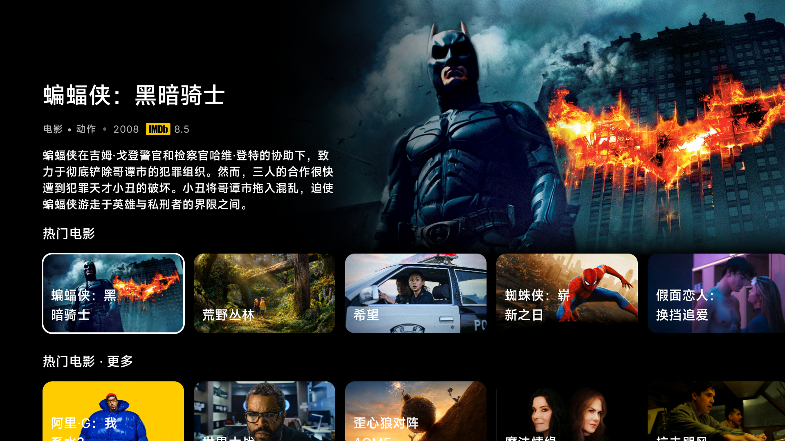

# Nuvio 中文电视首页配置与本机目录服务

把中文分类、流媒体片单、文件夹 Logo 和焦点背景规则部署到 Android TV。**安装完成后，电视自行运行目录服务，Mac / 电脑可以关机。** 电脑仅用于首次 ADB 安装、配置或维护；电视仍需联网，部分外部资料及播放源需要可用的 VPN。



配置基线：2026-11-01 小米 MiTV-MFTR0 / Android 14 / armeabi-v7a、Nuvio TV 1.0.0 的迁移快照。2026-11-02 整理公开；整理时电视未连接 ADB，未再次读取实时配置。跨机型、未来版本及播放源可用性需要重新验证。

## 包含的效果

- 继续观看由 Nuvio 自己记录、置于首页前部；聚焦节目时由现代布局显示背景和资料，不导入原作者的观看历史。
- 7 个置顶集合：精选推荐、流媒体平台、类型精选·电影、类型精选·剧集、地区电影、制片厂、年代佳片；保留热门电影/剧集原生目录行。
- 136 个目录：地区、类型、制片厂、年代和平台电影/剧集片单，以及第二页「更多」。26 个地区按 `with_origin_country` 筛选，合拍片可能同时属于多个地区。
- Netflix、Disney+、Prime Video、Apple TV+、HBO Max 保留品牌名/Logo；片名、简介优先中文，缺少中文资料时保留原文。
- 文件夹 `FOLLOW_LAYOUT`，现代布局下聚焦不同影片时切换顶部大图和简介；横向卡片、基础/更多行、集合末尾「更多」卡片。
- 地区封面使用该目录实际影片的随机背景图，缺少背景则用海报；8 秒内同一选择，之后可能更换，`no-store`，不使用国旗。

全部文件夹选项（形状、标题隐藏、焦点发光、背景图、来源、顺序）见 [集合配置](skills/media-center-bootstrap/assets/tv/collections-new.json)；查询规则见 [目录规则](skills/media-center-bootstrap/android-tv/assets/catalogs.json)。[显示规则详解](skills/media-center-bootstrap/references/tv-layout.md)。

## 快速安装到电视

### 1. 准备

电脑安装 Git、Python 3、Android SDK Platform Tools（adb）。电视开启 ADB 并授权电脑，先安装、登录 [Nuvio TV](https://github.com/NuvioMedia/NuvioTV/releases)，选择自己的个人资料。准备自己的 [TMDB API 密钥](https://www.themoviedb.org/settings/api)，保存在本地纯文本文件，例如 `/absolute/path/tmdb-key`，不要提交到仓库。

```bash
git clone https://github.com/AuroraRiseX/media-center-bootstrap.git
cd media-center-bootstrap
adb connect <电视IP>:5555
adb devices -l
```

下列命令中的 `<电视IP>` 必须替换成实际 IPv4 地址，不要保留尖括号。

### 2. 安装电视本机服务

```bash
python3 skills/media-center-bootstrap/android-tv/install.py \
  --serial <电视IP>:5555 \
  --catalogs skills/media-center-bootstrap/android-tv/assets/catalogs.json \
  --key-file /absolute/path/tmdb-key
```

脚本安装仓库内自行构建的 [APK](dist/nuvio-tv-catalog.apk)，将目录配置、密钥写入电视应用私有存储，开启本机服务和启动守护。APK 不含原作者 API key、账号、订阅或观看记录。此维护版 APK 开启 debuggable，便于通过已授权 ADB 的 `run-as` 写配置；不要向不可信电脑授予 ADB 权限。

本机服务仅监听 **`127.0.0.1:17863`**，不开放局域网管理接口，不提供视频文件或播放抓取。平台片单保留原 IMDb ID，避免中文翻译改变影片匹配。

小米待机可能 force-stop 第三方应用。脚本启用目录启动守护和通知监听的重绑定生命周期，并授予 `WRITE_SECURE_SETTINGS` 用于恢复自身守护设置；保留现有 Aerial 服务。守护仅订阅 Nuvio 窗口事件，不能读取窗口内容；通知监听不处理、保存通知内容。不要关闭这两个恢复组件。[源码与构建](skills/media-center-bootstrap/references/android-tv.md)。

### 3. 设置现代布局，导入栏目

电视 Nuvio 选择现代首页布局。打开 **设置 → 内容与发现 → 扩展 → 从手机管理**，保持二维码页开启。先生成预览和备份：

```bash
python3 skills/media-center-bootstrap/scripts/apply_tv_layout.py --tv <电视IP>
```

预览在 `private/tv-merge.json`，原配置备份在 `private/tv-merge.before.json`，两者都不会被 Git 收录。确认后执行：

```bash
python3 skills/media-center-bootstrap/scripts/apply_tv_layout.py --tv <电视IP> --apply
```

在电视弹框选择「确认」。脚本保留使用者现有在线扩展和模板以外的集合，更新同 ID 的7个模板集合，并安装电视本机目录。它会应用模板首页显示/隐藏顺序。

**新扩展首次安装后，Nuvio 可能自动启用全部新目录。请重新打开「从手机管理」，再执行一次上述 `--apply`，恢复模板隐藏设置。** 两次都在电视确认。待账号同步完成，重新打开 Nuvio，确认配置未回退。不要将此 localhost 地址直接用于没有安装目录服务的另一台设备。

### 4. 验收，无需电脑提供服务

```bash
adb -s <电视IP>:5555 shell 'printf "GET /health HTTP/1.0\r\nHost: localhost\r\n\r\n" | toybox nc -w 5 127.0.0.1 17863'
```

应返回 HTTP 200，内容包含 `"catalogs":136`、`"host":"Android TV"`、`"macRequired":false`。然后在电视检查中文平台片单、地区分类和焦点背景；重启及待机唤醒后再打开分类。最后断开电脑/关闭 Mac 服务，电视应仍能使用这些分类。影片播放请用自己的已授权播放源单独测试。

原机验证：136/136目录、48/48引用图片路径通过；开机启动、待机强停恢复、账号同步后保留配置通过。原机测试未验证影片播放，不能代表每个源均可用。[验证记录](verification/tv-migration-2026-11-01.json)。

## 让 AI 帮你安装

将 `skills/media-center-bootstrap` 复制到 AI 工具的 skills 目录，或让 AI 阅读其中的 `SKILL.md`。可以直接说：

> 阅读此仓库 README 和 media-center-bootstrap Skill。按电视本机方案安装 Nuvio 中文目录与首页布局，保留我的账号、观看记录和现有扩展。电视地址是……，TMDB key 文件在……。先检查设备，完成后验证重启、待机以及电脑不提供目录服务时仍能访问。

## 构建、修改和备份

- 修改栏目/图片规则：[集合 JSON](skills/media-center-bootstrap/assets/tv/collections-new.json)；栏目显示顺序：[layout.json](skills/media-center-bootstrap/assets/tv/layout.json)。
- 修改查询条件：`android-tv/assets/catalogs.json`；修改本地 Logo：`android-tv/assets/artwork/`，保持集合中地址文件名对应。
- 构建：Mac 上安装 JDK17、Android SDK platform 34 / build-tools 34.0.0，进入 `skills/media-center-bootstrap/android-tv` 执行 `./build.sh`，产物在 `build/nuvio-tv-catalog.apk`。复装脚本默认使用仓库根目录 `dist/` 的包，自行构建后需复制过去。
- `private/signing.keystore` 必须自行备份、不提交。新克隆本地构建会生成自己的签名，不能直接覆盖不同签名的既有安装；更新同一设备应保留原签名，避免卸载丢失配置。
- 原始截图中的影片图和品牌 Logo 归相应权利人；本仓库不提供流媒体订阅或访问授权。

## 旧版 Mac 模式与其它电视工具

[Mac 迁移](skills/media-center-bootstrap/references/nuvio.md)、[Aerial](skills/media-center-bootstrap/references/aerial.md)、[ClashFest](skills/media-center-bootstrap/references/clashfest.md) 仍保留供按需使用。Mac 配置为早期脱敏模板，不作为当前电视布局真源；其中 `${PRIVATE_SOURCE_*}` 必须由使用者提供自己的来源。

电视本机方案不需要运行 Mac Python 服务。仓库不包含任何人的 Nuvio 会话、播放历史、代理订阅、TMDB key、私密源完整地址或签名私钥。GitHub 公开仓库只用于分发代码与配置，不承载目录服务。

回退前保留导入脚本生成的 `.before.json`，通过 Nuvio 原生管理界面恢复原集合与扩展；确认恢复后再卸载 `local.nuvio.catalog`。旧 Mac 服务文件未删除，可按原安装方式重新启动。不要直接覆盖账号数据库。
